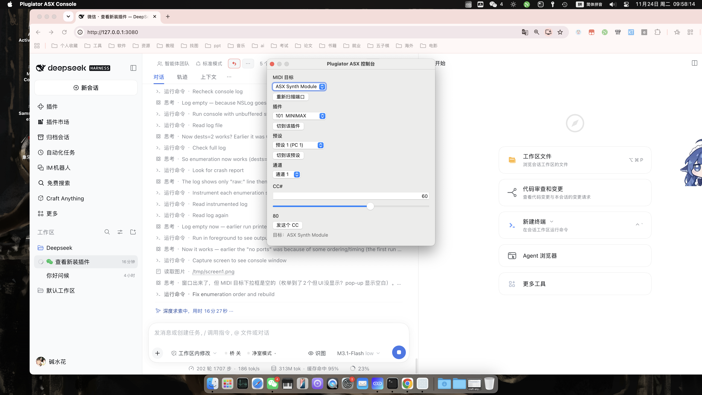

# Plugiator ASX 控制台

用 Mac 给 **Use Audio Plugiator ASX** 音源板发 MIDI 消息的小工具：切插件、切预设、调参数，
不用记 Program Change 号。



## 板子是什么

- 插在 CME UF 系列键盘扩展槽里的 **DSP 音源板**（厂商 Creamware Audio）。
- 板子自己是一个**标准 USB MIDI 设备**，系统里显示为 `ASX Synth Module`。
- 板子的音频输出**不走 USB**，声音必须走后面板的 Audio Out L/R 模拟线。

## 依据（Plugiator ASX User Manual v1.00，2008）

| 操作 | 消息 | 出处 |
|---|---|---|
| 切插件 | `PC 101–108` + 任意一个音（确认用） | p16 |
| 切预设 | `PC 1–100` | p17 |
| PC 109–127 | 无效 | p17 |
| 调参数 | `CC# + 值`（每插件的表在 p52–57） | p52–57 |

插件表：101 MINIMAX / 102 Lightwave / 103 B4000 / 104 Vocodizer /
105 Prodyssey / 106 Pro-12 / 107 Fmagia / 108 Drums'n'Bass

## 打包（你自己跑）

```bash
bash build.sh          # 编译出 build/Plugiator ASX Console.app
bash make-dmg.sh       # 打 DMG → release/Plugiator ASX Console-0.1.1.dmg
```

`make-dmg.sh` 必须在**你自己的终端**里跑：DSH 沙箱不放行 `hdiutil create`（建卷被拒）。

图标是代码画的（`tools/makeicon.m`），`build.sh` 会自动生成全套尺寸 + 打包成 `.icns`，
不需要任何外部素材。想改样式就改那个文件里的 `DrawIcon()`，重新 `bash build.sh` 即可。

## 用法

```bash
bash build.sh
open "build/Plugiator ASX Console.app"
```

1. **MIDI 目标** 选 `ASX Synth Module`（默认自动选中）
2. **插件** 选一个 → 点「切到该插件」
3. **预设** 选 1–100 → 点「切到该预设」
4. **CC#** 填号码、滑块调值 → 点「发这个 CC」
5. **通道** 默认通道 1

底部日志显示实际发出去的字节（如 `→ C0 66`）。

## 常见问题

**Q：切了预设，插件框怎么没跟着变？**
正常，手册 p16–17 定的机制就是分开的：

- 切插件 = `PC 101–108` **+ 弹一个音**确认（手册 p16 原文 `& playing a note to confirm`）
- 切预设 = 只发 `PC 1–100`，作用于**当前活动插件**（原文 `changing presets for the currently active plug-in`）

每个插件各带 100 个内部预设，所以「预设 1」在 MINIMAX 和 B4000 里是两个完全不同的音色，
切预设永远不会换引擎。插件框只在你点「切到该插件」时变（板子不回传状态，UI 无法自动同步）。
2026-11-24 实测：MINIMAX 预设 1 与 B4000 预设 1 音色完全不同 → 行为正确。

## 已知限制

- 2008 年的 **Plug-in Manager 装不上**（XULRunner 1.9pre 写的，现代 macOS 打不开）——
  所以这个工具走手册 p16 那条路：**PC + 一个音**，不需要 Manager。
- 板子的「走带键」在板子路上是 **CME 私有 CC**（CC0/CC2/CC6/CC7），
  不属于任何公开标准，且 **STOP/PLAY 完全没有信号** → 本工具**不处理走带**。
  走带请用 `cme-uf8-router`（走 5-pin 或琴 USB 口那条路）。

## 兼容性

universal2（x86_64 + arm64），Intel 与 Apple Silicon 都能跑。macOS 11+。

## 版本记录
- **0.1.1（2026-11-24）三向同步**：①滑条拖动即发（CC# 框空 =「未选择」，怎么拖都不发；与同号旋钮互相带动）②收板子回报（切预设/切插件的参数 dump、扭物理旋钮）→ 旋钮/滑条实时跳到板子真值，只改显示绝不回发 ③启动自动连「ASX Synth Module」回报源，状态行可见「已监听板子回报」。
- 0.1.0 初版：切插件（PC101+音）/ 切预设 / 手发 CC / 旋钮面板 + 搜索 + 4 张手册参数表 / 图标 + 打包脚本。
